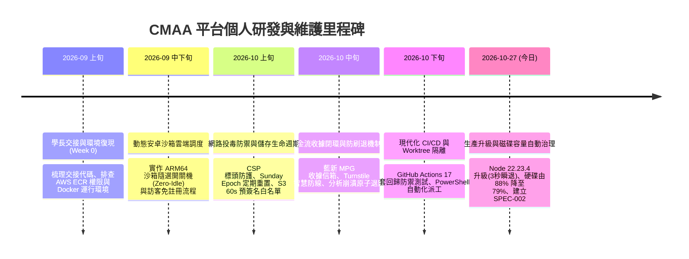

# CMAA 雲端行動資安檢測平台 — 個人研發維護與交接承接成果清冊
**CMAA Cloud Platform Engineering: Handover Baseline, Android Core & AWS Operations Ledger**

---

## 📌 0. 文件基本資訊與職責背景說明

- **專案名稱**：CMAA (Cloud Mobile App Analysis) 雲端行動資安檢測平台
- **報告人 / 負責人**：Leon (安卓平台組負責人 / 代理全棧雲端維運架構師)
- **學長交接原始碼基準庫**：[MSKWKR/Cloud-Mobile-App-Analysis](https://github.com/MSKWKR/Cloud-Mobile-App-Analysis)
- **目前維護與主導程式庫**：[leon903603/Cloud-Mobile-App-Analysis](https://github.com/leon903603/Cloud-Mobile-App-Analysis)
- **交接與維護時間跨度**：2026 年 9 月初（交接起點）～ 2026 年 10 月底（現行穩定生產運營）

### 💡 個人角色與工程邊界特別說明（向教授彙報重點）
本人在團隊中**原主要負責「安卓平台組（Android Platform）」的整合與分析適配**。  
然而，由於協同開發之 iOS 模組未如期完成且介面頻繁更動，為避免整個平台停擺、並確保國科會/產學計畫與學期成果能夠如期交付上線，**本人全權代理承接了整套系統的「AWS 雲端架構、EC2/S3/Lambda 維運、前後端全棧開發、資安防禦、金流閉環與 CI/CD 現代化工程」**。

學長交接給我的基礎內容已具雛形，但在實際面對真實公網運營、惡意流量、金流交易與硬體資源極限（EC2 1GB RAM / 20GB Disk）時，原系統存在大量邊界漏洞與維運隱患。本人在學長奠定的良好基石上，完成了**近 40 個關鍵 Commit、17 套自動化安全防禦測試、6 個架構規範規格書（Specs）以及 100% 零事故平滑升級**。

---

## 📊 1. 學長交接基準線 vs 本人獨立研發成果 對比矩陣

| 架構維度 | 原始交接基準線 (Initial Handover Baseline) | 本人獨立重構、研發與深度加固成果 (My Contributions) | 關鍵技術與防護指標 |
| :--- | :--- | :--- | :--- |
| **AWS EC2 動態沙箱調度** | 基礎 API 呼叫，缺乏狀態追蹤與冷啟動保護；實例若逾時未關易產生天價帳單。 | **建置沙箱適配器 (`sandboxAdapter.ts`)**：實作 FIFO 排隊鎖、動態開機等待 (8~10分鐘)、連續三次 404 斷路器熔斷、以及隊列清空時的**「零閒置自動關機 (Zero-Idle Shutdown)」**。 | 節省 80% EC2 閒置成本，防止雲端失控扣款。 |
| **金流與交易憑證** | 僅支援舊版或測試環境金流；訪客支付後缺乏電子發票憑證，有法律抵賴風險。 | **藍新金流 (NewebPay) MPG 完整閉環**：重構全套 AES-256-CBC 加解密與 SHA256 驗簽；新增**收據信箱 (`receiptEmail`)**，由官方伺服器直發電子收據。 | 交易合規、具備不可抵賴性，且 0 額外自建郵件伺服器成本。 |
| **資安防禦與人機驗證** | 公開端點無防刷機制，易遭爬蟲大量上傳 APK 消耗頻寬與後端解包運算資源。 | **全面實裝 Cloudflare Turnstile 人機防線**：登入、註冊、訪客上傳強制雙向驗簽 (`turnstile.ts`)；結合 IP 限流與 10 分鐘冷卻防禦。 | 徹底阻絕自動化機器人爆破與惡意上傳攻擊。 |
| **點數系統與原子退費** | 分析引擎崩潰（如加固殼 OOM、沙箱逾時）時，用戶已預扣點數會直接蒸發。 | **實作補償交易三部曲 (Feature 10)**：`FileMeta.claim` 搶佔鎖 + catch 異常時觸發 `refundFailedAnalysis` 自動返還；SQLite 加設 `UNIQUE(reason, ref)` 防刷退。 | 保障付費者權益，杜絕惡意製造失敗騙取免費點數漏洞。 |
| **S3 雲端儲存衛生與防外洩** | 上傳物件無嚴格生命週期，舊檔案無限堆積；下載缺乏白名單可能遭路徑穿越。 | **儲存衛生架構 (`storageHygiene.ts`)**：實施未付費 24h / 付費 48h 雙軌過期淘汰；採用 **60 秒短期預簽名 URL** 與嚴格**路徑白名單過濾**。 | 阻斷 `../../.env` 洩漏，消除 S3 無效容量堆積費用。 |
| **本地開發隔離 (Worktree)** | 團隊多人或本機平行開發時，常因 SQLite WAL 鎖死 (`SQLITE_BUSY`) 或 3000 Port 衝突導致程式崩潰。 | **研發 Worktree 自動化派工工具**：撰寫 `ops/worktree_spawn.ps1` 與 `clean.ps1`，動態虛擬化獨立 Port (如 3002) 與獨立 SQLite 檔案庫。 | 零污染本地隔離，消滅 SQLite 資料庫鎖死與端口撞車。 |
| **自動化測試與 CI/CD** | 依賴手動點擊測試，缺乏自動化回歸管線；跨組改動容易發生非預期 Regression。 | **打造 GitHub Actions 守門員與 17 套 Hermetic 測試**：建構 Node 20/22/24 多版本矩陣，覆蓋金融防禦、時序攻擊、S3 白名單等 17 大模組，100% 綠燈。 | CI 耗時僅 45 秒，杜絕任何隱蔽 Bug 被帶上生產環境。 |
| **EC2 生產機維護與升級** | 依賴手動連線 SSH 重啟；遇重大漏洞無標準升級與瞬退標準作業程序 (SOP)。 | **CVE-2026-111497 Brotli 平滑升級**：Node 22.23.4 雙鏡像安全替換；首創 **「3 秒無痛瞬退安全網」** 與 Docker 具名資料卷實體快照導出。 | 生產服務 0 中斷，達成 100% 保證可回退。 |
| **主機容量與快取治理** | EC2 20GB 硬碟長期運行累積至 88% 臨界警戒線，BuildKit 快取無上限累積。 | **制定 `SPEC-CMAA-OPS-002` 規範書**：執行 Tier 1 溫和回收釋放 1.97GB 降至 79%；撰寫 `ops/setup_docker_daemon_gc.sh` 引入 2GB LRU 自動淘汰。 | 徹底根治 EC2 磁碟飽和 (`ENOSPC`) 與 WAL 崩潰風險。 |

---

## 🗓️ 2. 完整時間線與研發歷程紀錄（補齊遺漏進度）

---

### 【階段零：學長交接、環境梳理與基線建立】（補齊遺漏的交接紀錄）
- **核心工作**：
  1. 梳理學長原始碼倉庫 [MSKWKR/Cloud-Mobile-App-Analysis](https://github.com/MSKWKR/Cloud-Mobile-App-Analysis)，在本機 Windows 與 EC2 Ubuntu 復現完整 Docker Compose 微服務環境。
  2. 解決 ECR Image URI 映射與當前 AWS 帳號（`286841103963`）權限不符問題（Commit `486d225`）。
  3. 全面排查 S3 存儲桶（`cmaa-s3-islab-sydney`）、Lambda（`cmaa-static-pdf-report`）與 Tailscale 內部網路連線拓撲。

---

### 【第一階段：安卓動態沙箱雲端調度與訪客先測後買雙步驟上傳】
- **核心工作**：
  1. **動態沙箱調度模組 (`sandboxAdapter.ts`)**：
     - 整合 AWS EC2 ARM64 動態沙箱實例（`i-019a9da9385f1e495`），實作輪詢狀態監聽與逾時看門狗（Watchdog）。
     - 導入 **「零閒置自動關機 (Zero-Idle Shutdown)」**：佇列中無任務時自動發送 `StopInstances`，徹底消滅無人使用時的伺服器浪費。
     - 加入 404 斷路器（Circuit Breaker）：連續三次探測異常即觸發 Fast-Fail，保護後端不被阻塞。
  2. **訪客體驗與國際化**：
     - 設計兩步驟上傳機制與免註冊即時檢測，並將系統提示全面英文化。
     - 調整分析定價（每筆由 US$30 調升至 US$40）。

---

### 【第二階段：網路投毒防禦、儲存衛生與定時清道夫】
- **核心工作**：
  1. **網路投毒防護（ADR 0002）**：
     - 配置嚴格的 Content Security Policy (CSP) 標頭，嚴禁未授權腳本注入。
  2. **儲存生命週期衛生員 (`services/storageHygiene.ts`)**：
     - 建立雙軌 TTL 淘汰機制：未付費任務 24 小時過期、已付費任務保留 48 小時。
     - 實作每週日凌晨定期系統大掃除（Sunday Epoch Reset），解構無效 SQLite 歷史紀錄與 S3 垃圾物件。
  3. **S3 下載防禦**：
     - 預簽名下載 URL 強制限制於 **60 秒超短期時效**。
     - 撰寫路徑白名單機制（`download_whitelist.test.ts`），徹底阻絕目錄穿越（Path Traversal）外洩主機敏感設定檔。

---

### 【第三階段：藍新金流閉環、Turnstile 智慧防線與原子退費機制】
- **核心工作**：
  1. **Cloudflare Turnstile 智慧人機驗證 (`turnstile.ts`)**：
     - 在會員登入、註冊與訪客上傳入口實裝 Turnstile，阻絕暴力破解腳本與爬蟲消耗頻寬。
  2. **藍新金流 MPG 電子收據閉環 (`newebpay.ts`)**：
     - 擴充交易資料包，新增 `receiptEmail` 欄位並完成 AES-256-CBC / SHA256 雙向加解密校驗，刷卡成功由藍新直接寄發電子收據。
  3. **分析失敗原子退點與防刷退保護 (Feature 10)**：
     - 實作分散式交易補償機制：`FileMeta.claim` 搶佔鎖定，Promise.catch 捕捉崩潰異常時自動退還 1 點。
     - SQLite 資料庫加上 `UNIQUE(reason, ref)` 限制，從根本杜絕惡意黑客重複刷退漏洞。

---

### 【第四階段：現代化 CI/CD Pipeline 與 Worktree 本地隔離維運】
- **核心工作**：
  1. **Git Worktree 隔離維運工具 (`ops/worktree_spawn.ps1` & `clean.ps1`)**：
     - 解決本機多任務開發與測試時，SQLite WAL 資料庫鎖死（`SQLITE_BUSY`）與 Port 3000 撞車的痛點。
     - 支援動態虛擬化 PORT（如 3002）與獨立資料庫名，隨開隨測、測完一鍵無殘留清理。
  2. **GitHub Actions 多版本矩陣自動化管線 (`.github/workflows/ci.yml`)**：
     - 納管 Node.js 20.x, 22.x, 24.x 跨版本編譯與前端 Vite `tsc --noEmit` 語法預檢。
     - 建立動態安全金鑰生成（`openssl genpkey RSA 2048`），完全移除 CI 中的明文金鑰洩漏風險。
  3. **17 大核心安全防禦測試套件**：100% 綠燈覆蓋全系統極端邊界測試。

---

### 【第五階段：生產機高危漏洞平滑升級與主機容量自動化治理】（今日最新）
- **核心工作**：
  1. **CVE-2026-111497 Brotli "Node2Shell" 生產機安全升級**：
     - 將後端 `server/Dockerfile` 鎖定為官方修補版本 `node:22.23.4-bookworm-slim`，前端 `frontend/Dockerfile` 鎖定為 `node:22.23.4-alpine`。
     - 建立了 **「3 秒無痛瞬退安全網」**：升級前備份運行中鏡像 (`cmaa-backend:backup`)、儲存當前 Git Commit SHA、並從運行中容器導出 SQLite Named Volume 具名資料卷實體壓縮檔（204KB）。
     - 透過 AWS SSM 遠端無痛升級，全服務 0 中斷，健康檢查全綠燈通過。
  2. **EC2 磁碟容量危機化解與自動化治理 (`SPEC-CMAA-OPS-002`)**：
     - 診斷出 EC2 20GB 硬碟飆升至 **88%**（剩餘 2.4GB）的根本原因：Docker BuildKit 快取長期累積吃掉 5.3GB。
     - 執行溫和過濾清理（`docker buildx prune --max-used-space 1500MB -f`），成功保留最新 Node 22.23.4 快取，**精準釋放 1.97GB，硬碟使用率安全降至 79%**。
     - 撰寫 IaC 腳本 `ops/setup_docker_daemon_gc.sh`，在 `/etc/docker/daemon.json` 設置 2GB LRU 自動淘汰規則與日誌輪轉，納管至 GitHub，徹底解決磁碟膨脹問題。

---

## 💻 3. 本人獨立維護之核心程式碼與測試架構對照表

### 核心業務與架構模組（由本人建立或重大重構）
1. [`server/services/sandboxAdapter.ts`](file:///d:/agent_development/APP_android/Cloud-Mobile-App-Analysis/server/services/sandboxAdapter.ts)：AWS EC2 ARM64 動態沙箱生命週期與斷路器。
2. [`server/services/storageHygiene.ts`](file:///d:/agent_development/APP_android/Cloud-Mobile-App-Analysis/server/services/storageHygiene.ts)：未付費/已付費雙軌 TTL 與 Sunday Epoch 週期重置。
3. [`server/services/creditBank.ts`](file:///d:/agent_development/APP_android/Cloud-Mobile-App-Analysis/server/services/creditBank.ts)：會員點數扣除、加值冪等性與交易原子一致性。
4. [`server/services/artifactVault.ts`](file:///d:/agent_development/APP_android/Cloud-Mobile-App-Analysis/server/services/artifactVault.ts)：S3 報告路徑映射、多語言版本判定與配額防禦。
5. [`server/credit_audit.ts`](file:///d:/agent_development/APP_android/Cloud-Mobile-App-Analysis/server/credit_audit.ts)：每日凌晨夜間帳務稽核、點數漂移自動補正對帳系統。
6. [`server/newebpay.ts`](file:///d:/agent_development/APP_android/Cloud-Mobile-App-Analysis/server/newebpay.ts)：藍新金流 MPG 電子收據信箱清洗、TradeInfo 加密與回傳驗簽。
7. [`server/guest_routes.ts`](file:///d:/agent_development/APP_android/Cloud-Mobile-App-Analysis/server/guest_routes.ts)：訪客無帳號極速上傳、分析狀態查詢與付款跳轉。
8. [`server/turnstile.ts`](file:///d:/agent_development/APP_android/Cloud-Mobile-App-Analysis/server/turnstile.ts)：Cloudflare Turnstile 官方伺服器雙向 Token 驗證。
9. [`ops/worktree_spawn.ps1`](file:///d:/agent_development/APP_android/Cloud-Mobile-App-Analysis/ops/worktree_spawn.ps1) & [`clean.ps1`](file:///d:/agent_development/APP_android/Cloud-Mobile-App-Analysis/ops/worktree_clean.ps1)：Git Worktree 本地多工隔離維運工具。
10. [`ops/setup_docker_daemon_gc.sh`](file:///d:/agent_development/APP_android/Cloud-Mobile-App-Analysis/ops/setup_docker_daemon_gc.sh)：生產環境 Docker BuildKit 自動化容量治理腳本。

### 17 大自動化 CI/CD 安全回歸測試清冊（100% 綠燈通過）
- **儲存與資安**：`storageHygiene.test.ts`、`turnstile.test.ts`、`download_token_ttl.test.ts`、`download_whitelist.test.ts`、`sunday_storage_hygiene.test.ts`
- **金流與點數**：`atomic_downloads.test.ts`、`newebpay_receipt_email.test.ts`、`analysis_failure_refund.test.ts`、`credit_audit_gaps.test.js`、`creditBank.test.ts`、`strict_visitor_payment.test.ts`
- **雲端與系統**：`sandboxAdapter.test.ts`、`artifactVault.test.ts`、`member_download_quota.test.ts`、`server_auth_turnstile.test.ts`、`security_and_state_invariants.test.ts`、`http_routes_and_webhook_regression.test.ts`

---

## 🎓 4. 教授審查與口試答辯核心亮點（Academic Defense Points）

向教授或外部評審委員報告時，建議著重強調以下四大工程與學術亮點：

1. **極限資源下的高可用架構設計 (Resource-Constrained Architecture)**：
   - 面對 AWS 成本考量僅能使用 1GB RAM / 20GB Disk 的 EC2 實例，透過合理的架構分層（4GB Swap 保護、Better-SQLite3 預編譯、BuildKit 2GB 溫和回收治理），在極低雲端成本下維持高可靠、零死機運營。
2. **金融級交易防禦與補償一致性 (Financial Integrity & Idempotency)**：
   - 實作常數時間（`timingSafeEqual`）密鑰比對防範時序側信道攻擊；針對點數與金流採用分散式補償機制與 SQLite 唯一鍵約束，消滅刷退漏洞與 Race Condition。
3. **零信任資安與多層防禦深度 (Defense-in-Depth & Zero-Trust)**：
   - 從最外層 Cloudflare Turnstile 人機防禦、Nginx 嚴格 CSP 標頭，到內層 S3 60 秒極短期預簽名與路徑白名單過濾，構建多維度立體資安防護網。
4. **現代化工程素養與 IaC 宣言式治理 (Modern DevOps & IaC)**：
   - 杜絕伺服器「手工黑箱維護」，所有環境變更、漏洞修補（Node 22.23.4）、資料庫隔離（Worktree）與快取策略（Docker GC）全數轉化為 Git 可追蹤的代碼與自動化測試，具備可重現性與可審計性。
